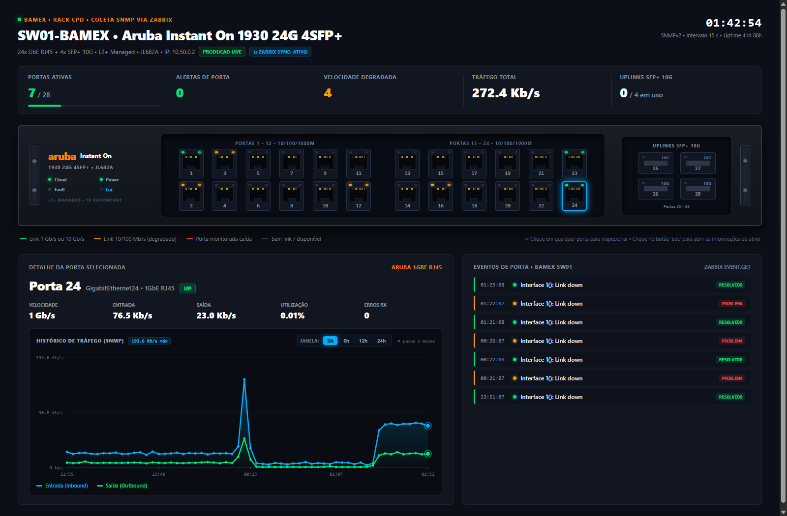
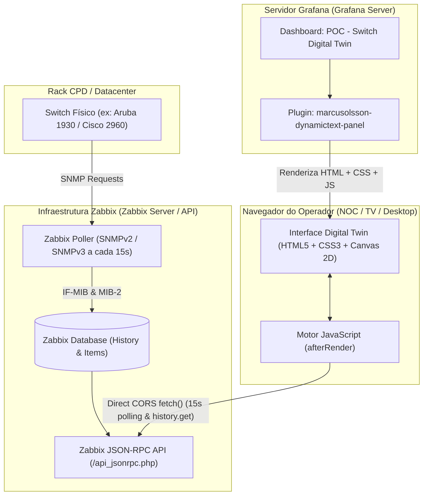

# 🔌 Grafana Switch Digital Twin (Zabbix SNMP)

[](https://grafana.com/)
[](https://www.zabbix.com/)
[](https://grafana.com/grafana/plugins/marcusolsson-dynamictext-panel/)
[](https://opensource.org/licenses/MIT)
[](https://github.com/IDhexter/Grafana-Switch)

Uma solução completa e pronta para produção para criar **Gêmeos Digitais (Digital Twins)** interativos e fiéis ao hardware de switches de rede no **Grafana**, alimentados por telemetria SNMP em tempo real extraída diretamente do **Zabbix**.

Desenvolvido para operar em ambientes de missão crítica (NOCs, Datacenters, Provedores e Racks de Telecom), este projeto demonstra a implementação completa para o switch **Aruba Instant On 1930 24G 4SFP+ (JL682A)** e fornece a metodologia, arquitetura e scripts para reproduzir em **qualquer modelo ou fabricante de switch** (Cisco, Dell, Mikrotik, Ubiquiti, Huawei, Juniper, HP ProCurve, Fortinet).

---

## 📸 Demonstração Visual

### Painel Principal do Switch com Gráfico Responsivo e Botões Segmentados (v46)


---

## 🌟 Principais Recursos

1. **Modelagem Fiel de Hardware 1U (HTML5 + CSS3 Puro)**:
   * Chassi metálico usinado com orelhas de rack laterais e parafusos sextavados de fixação.
   * Disposição espacial modular em bancos (*PORTAS 1 - 12* e *PORTAS 13 - 24*) com ranhura divisória central.
   * 24 portas RJ45 GbE generosas (50x60px) com pinos dourados, travas RJ45 e LEDs duplos de status/atividade por porta.
   * 4 gaiolas metálicas para módulos SFP+ 10GbE em grade 2x2.

2. **LEDs de Sistema Inteligentes Conectados à Telemetria Real**:
   * ☁️ **Cloud**: Pulsa em ciano durante as chamadas da API do Zabbix. Fica verde esmeralda contínuo em caso de sucesso (com tooltip do timestamp da última sincronização) e âmbar em caso de falha de conexão. Permite clique direto para forçar sincronização imediata.
   * ⚡ **Power**: Monitora a disponibilidade operacional do switch via `icmpping`. Fica verde quando o switch está online e vermelho caso o ping falhe.
   * 🚨 **Fault**: Integrado à chamada `problem.get` do Zabbix. Fica apagado/cinza neutro (`#374151`) quando o switch está 100% saudável. Caso haja alarmes ativos, acende em vermelho pulsante (`@keyframes swFaultPulse`) e sincroniza o card "ALERTAS DE PORTA".
   * 🔍 **Loc (Informações e Inventário do Ativo)**: Ao clicar no LED `Loc`, acende em ciano e abre uma **Gaveta Técnica de Inventário do Ativo** contendo dados cadastrais oficiais do Zabbix via SNMP MIB-2: `sysDescr`, `sysLocation`, `sysContact`, `sysName`, `sysObjectID`, firmware, Linux kernel, U-Boot e link direto para a Web GUI de gerenciamento do equipamento.

3. **Detecção e Destaque de Portas Degradadas**:
   * Identifica automaticamente portas operacionais (`OperStatus == UP`), mas com velocidade auto-negociada rebaixada para **100 Mb/s (Fast Ethernet)** ou **10 Mb/s** (em vez do 1 Gb/s nativo).
   * Destaca essas portas em **Âmbar (`#f59e0b`)** no painel frontal e no contador de KPI, permitindo ao time de infraestrutura localizar instantaneamente cabos rompidos, crimpagens defeituosas ou dispositivos legados.

4. **Gráfico Histórico Auto-Redimensionável (HTML5 Canvas + ResizeObserver)**:
   * Motor gráfico vetorial desenvolvido em Canvas 2D sem dependência de bibliotecas externas pesadas.
   * **Aspect-Ratio Adaptativo**: Utiliza `clamp(170px, 18vw, 260px)` e `ResizeObserver`. Em janelas normais ele mantém altura compacta (~170px), e ao entrar em **tela cheia ou monitores ultrawide (1080p/4K)**, a altura se expande automaticamente para até **260px**, eliminando o visual achatado.
   * **Régua Dinâmica no Eixo Y**: Valores numéricos calculados dinamicamente com base no pico máximo (ex: `34.6 Kb/s`, `17.3 Kb/s`, `0 bps`) com linhas de grade de referência.
   * **Eixo X Inteligente**: Marcas de tempo proporcionais adaptativas ao período selecionado.

5. **Barra de Botões Segmentados de Janela Temporal (`[ 3h ] [ 6h ] [ 12h ] [ 24h ]`)**:
   * Permite ao operador alternar instantaneamente entre janelas de **3 Horas**, **6 Horas**, **12 Horas** e **24 Horas** com um único clique.
   * O botão ativo fica destacado em **ciano neon brilhante (`#00b0ff`)**.
   * Dispara consulta em tempo real à API do Zabbix (`history.get` com `time_from`), redesenhando o gráfico e as marcas de tempo imediatamente sem recarregar a página.

6. **Interatividade Avançada de Inspeção (Hover HUD Tooltip)**:
   * Linha de mira vertical tracejada (*crosshair*) que acompanha o cursor e trava no ponto amostral mais próximo.
   * Destaque com anéis concêntricos brilhantes nas curvas de Entrada e Saída.
   * **Ancoragem Inteligente em 3 Zonas**: O cartão flutuante possui `white-space: nowrap; width: max-content;` e se ancora automaticamente nas margens esquerda e direita, **nunca colidindo com as bordas nem quebrando linhas de texto**.

7. **Painel de Eventos de Porta em Tempo Real (Zabbix `event.get`)**:
   * Linha do tempo cronológica com os últimos eventos de link das interfaces do switch.
   * Exibe horário exato (`HH:mm:ss`), porta, descrição do evento e selo de gravidade (`RESOLVIDO` em verde ou `PROBLEMA` em vermelho).

8. **Filtro Crítico de Interfaces Virtuais SNMP**:
   * Switches gerenciados modernos criam interfaces virtuais internas (`propVirtual` com `ifIndex >= 100000`).
   * O pipeline possui filtros estritos tanto no PowerShell quanto no JavaScript do navegador para ignorar `ifIndex >= 100000`, impedindo que interfaces lógicas sobrescrevam a velocidade real da porta física (como a Porta 1 em 1 Gb/s).

---

## 🏗️ Arquitetura de Dados



---

## 📋 Pré-Requisitos

1. **Zabbix Server (v6.0, v6.4 ou v7.0+)**:
   * Switch monitorado via SNMP com template padrão de rede (`Network Generic Device by SNMP` ou similar).
   * Token de API gerado no Zabbix (*Administration ➔ API Tokens* ou *Users ➔ API Tokens*).
2. **Grafana (v10+ ou v11+)**:
   * Plugin **Business Text** instalado:
     ```bash
     grafana-cli plugins install marcusolsson-dynamictext-panel
     ```
   * Reinicie o serviço do Grafana após a instalação (`systemctl restart grafana-server` ou equivalente).
3. **PowerShell (v5.1+ no Windows ou PowerShell 7+ no Linux/macOS)**.

---

## 🚀 Como Executar o Deploy Automatizado (3 Minutos)

### Opção 1: Deploy Automatizado via PowerShell (Recomendado)

1. **Clone o repositório**:
   ```bash
   git clone https://github.com/IDhexter/Grafana-Switch.git
   cd Grafana-Switch
   ```

2. **Crie e configure seu arquivo `.env`**:
   Copie o modelo de exemplo:
   ```bash
   cp .env.example .env
   ```
   Edite com os dados do seu ambiente:
   ```ini
   # ZABBIX
   ZABBIX_URL="http://<IP_DO_ZABBIX>/api_jsonrpc.php"
   ZABBIX_TOKEN="seu_token_api_zabbix_aqui"
   ZABBIX_HOST_ID="10001"

   # GRAFANA
   GRAFANA_URL="http://<IP_DO_GRAFANA>:3000"
   GRAFANA_DASHBOARD_UID="seu_dashboard_uid"
   GRAFANA_USER="seu_usuario_grafana"
   GRAFANA_PASSWORD="sua_senha_grafana"
   ```

3. **Execute o script de compilação e deploy**:
   ```powershell
   powershell -ExecutionPolicy Bypass -File scripts\build_aruba_interactive_twin.ps1
   ```
   O script irá:
   * Conectar à API do Zabbix e coletar a telemetria inicial de todas as 28 portas.
   * Detectar automaticamente interfaces ativas, degradadas e tráfego total.
   * Compilar o HTML usinado e o motor JavaScript do Canvas responsivo.
   * Publicar ou atualizar o dashboard diretamente na API do Grafana.

4. **Abra o Grafana**:
   Acesse a URL informada pelo terminal e visualize o switch operando ao vivo!

---

### Opção 2: Importação Direta do Dashboard JSON no Grafana

Se preferir não rodar scripts e importar manualmente pelo navegador:

1. Baixe o arquivo sanitizado [`grafana/dashboards/aruba_instant_on_1930.json`](grafana/dashboards/aruba_instant_on_1930.json).
2. No Grafana, vá em **Dashboards ➔ New ➔ Import**.
3. Carregue o arquivo JSON ou cole seu conteúdo.
4. No painel Dynamic Text importado, edite a aba **After Content Ready** substituindo as variáveis `__ZABBIX_URL_PLACEHOLDER__` e `__ZABBIX_TOKEN_PLACEHOLDER__` pelas credenciais do seu Zabbix.
5. Salve o dashboard.

---

## 📖 Guia de Replicação para Qualquer Outro Switch (Cisco, Dell, HP, Mikrotik, etc.)

A arquitetura do projeto foi projetada de forma modular. Para replicar para **qualquer outro switch**, basta seguir estes passos:

### 1. Mapeamento dos Itens SNMP no Zabbix
Todo switch gerenciado expõe as métricas padronizadas pela MIB-II (`RFC 1213` e `IF-MIB`):

| Métrica | Chave do Item no Zabbix | Significado / Valores |
| :--- | :--- | :--- |
| **Status Operacional** | `net.if.status[ifOperStatus.X]` | `1` = UP (Verde), `2` = DOWN (Cinza) |
| **Velocidade** | `net.if.speed[ifHighSpeed.X]` ou `net.if.speed[ifSpeed.X]` | `1000000000` = 1 Gbps, `100000000` = 100 Mbps |
| **Tráfego Entrada (In)** | `net.if.in[ifHCInOctets.X]` | Bits por segundo (calculado via delta Zabbix) |
| **Tráfego Saída (Out)** | `net.if.out[ifHCOutOctets.X]` | Bits por segundo (calculado via delta Zabbix) |
| **Erros de Entrada** | `net.if.in.errors[ifInErrors.X]` | Contador de pacotes descartados / CRC |
| **Localização Física** | `system.location[sysLocation.0]` | MIB-2 padrão (`Rack CPD`, `Sala TI`) |
| **Contato do Responsável**| `system.contact[sysContact.0]` | MIB-2 padrão (`NOC`, `Engenharia`) |
| **Disponibilidade** | `icmpping` | `1` = Online (Power Verde), `0` = Offline (Power Vermelho) |

### 2. Adaptação do Layout Físico
No script PowerShell:
* **Switch de 24 Portas**: 2 linhas de 12 portas (Ímpares em cima `1, 3, 5... 23`, Pares embaixo `2, 4, 6... 24`).
* **Switch de 48 Portas**: 2 linhas de 24 portas (Ímpares `1, 3... 47`, Pares `2, 4... 48`).
* **Uplinks Ópticos (SFP+ / QSFP)**: Gaiolas posicionadas à direita com identificação de 10G, 25G, 40G ou 100G.

### 3. Ajuste do Host ID
No `.env`, altere `ZABBIX_HOST_ID` para o ID do novo switch no Zabbix e rode o script novamente.

---

## ⚠️ Armadilhas Técnicas e Gotchas de Produção (Obrigatório Conhecer)

Se você for desenvolver ou customizar painéis com o plugin **Business Text (`marcusolsson-dynamictext-panel`)**, guarde estas lições aprendidas em produção:

### 1. A Armadilha de Indentação Markdown
> [!CAUTION]
> O plugin Business Text interpreta o conteúdo HTML através de um parser CommonMark. **Qualquer linha com 4 espaços ou mais de indentação que seja precedida por uma linha em branco é tratada como bloco de código (`<pre><code>`)**.
> 
> Se isso acontecer, seu HTML será escapado e exibido como texto puro monoespaçado na tela, quebrando o DOM e desativando o JavaScript.
> 
> **Solução**: Sempre processe a string HTML no PowerShell com `$cleanLines = $htmlContent -split "`r?`n"` e aplique `.Trim()` para eliminar indentações e linhas vazias antes de enviar ao Grafana.

### 2. Por que Usar Botões Segmentados em Vez de `<select>` Nativo no Grafana
> [!WARNING]
> O Grafana roda sobre React 18, que possui um sistema de eventos sintéticos para formulários.
> * Tags `<select>` nativas sofrem interferência de CSS global do Grafana (`appearance: none;`), fazendo com que o texto selecionado fique invisível no tema escuro.
> * O evento inline `onchange="..."` de um `<select>` nativo pode ser suprimido pelo React, impedindo a atualização do gráfico.
> 
> **Solução**: Utilize botões segmentados (`<button type="button">`) com classes e `onclick="..."`. Eles oferecem feedback visual imediato (botão ativo em ciano), não sofrem interferência do React e executam a troca de dados instantaneamente.

### 3. Filtro de Interfaces Virtuais (`ifIndex >= 100000`)
> [!IMPORTANT]
> O firmware de switches modernos (como Aruba CX, Instant On e Cisco) gera interfaces lógicas internas (`propVirtual`) que repetem os nomes das interfaces físicas (ex: `Interface 1()`), mas com `ifIndex` alto (ex: `ifSpeed.100000 = 0`).
> 
> Se não filtradas, a interface virtual sobrescreve a porta física real, exibindo velocidade zerada (`--`).
> 
> **Solução**: Sempre filtre com `if ($key -match '\.(\d+)\]') { if ([int64]$matches[1] -ge 100000) { continue } }` tanto no PowerShell quanto no JavaScript do navegador.

### 4. Ciclo de Vida do React e Limpeza de Timers
> [!TIP]
> A cada atualização de variáveis do dashboard, o Grafana reexecuta o script `afterRender`. Se você criar um `setInterval` sem limpá-lo, múltiplos timers se acumularão, sobrecarregando o navegador e o Zabbix.
> 
> **Solução**: Guarde as instâncias no escopo global (`window.__aruba_zabbix_timer`) e execute `clearInterval` antes de instanciar novos timers.

---

## 📂 Estrutura do Repositório

```text
├── assets/
│   ├── aruba_switch_dashboard.png       # Screenshot em produção (Dashboard com 24h ativo)
│   └── port_selection_click.png         # Screenshot de detalhe de porta selecionada
├── grafana/
│   └── dashboards/
│       ├── aruba_interactive_twin.html  # Template HTML puro gerado pelo pipeline
│       └── aruba_instant_on_1930.json   # Dashboard exportado e 100% sanitizado para importação direta
├── scripts/
│   ├── build_aruba_interactive_twin.ps1 # Script principal de automação, compilação e deploy via REST API
│   ├── export_sanitized_dashboard.ps1   # Script utilitário para exportar o JSON limpo sem senhas
│   └── git_commit_and_push.ps1          # Utilitário seguro para versionamento com Git
├── .env.example                         # Arquivo de exemplo para configuração rápida
├── .gitignore                           # Proteção de credenciais locais (.env) e arquivos scratch
└── README.md                            # Esta documentação completa
```

---

## 📄 Licença

Este projeto está sob a licença [MIT](LICENSE) - sinta-se livre para usar, adaptar, modificar e estender para seus próprios switches, data centers e clientes.

---

**Desenvolvido por [IDhexter](https://github.com/IDhexter)**  
*Observabilidade Avançada, Automação de Infraestrutura de Redes, Zabbix & Grafana.*
