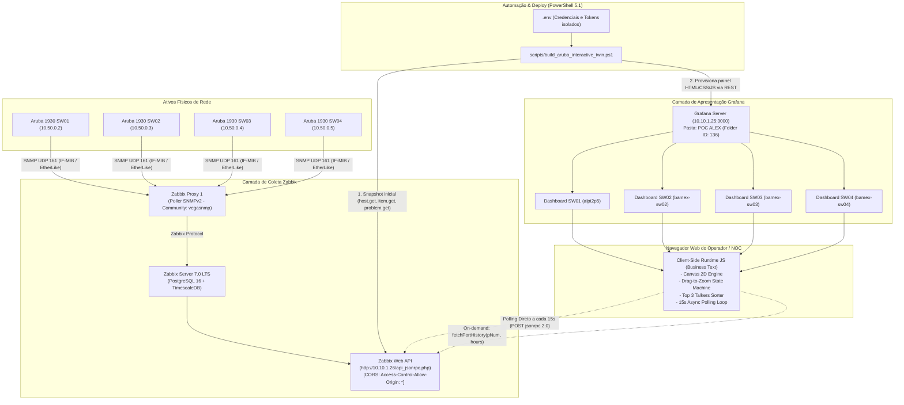
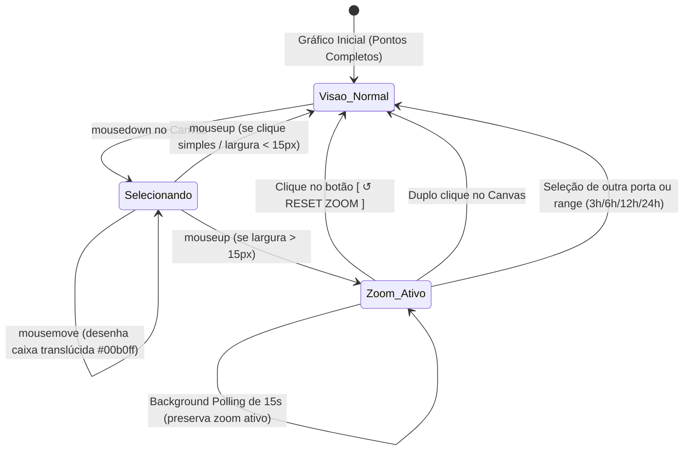

# Especificação Técnica Completa: Gêmeo Digital (Digital Twin) do Switch Aruba Instant On 1930
**Plataforma de Monitoramento e Observabilidade: Zabbix 7.0 LTS & Grafana OSS**  
**Documento para Revisão Técnica, Auditoria de Código e Integração com IA Auxiliar**  
*Versão da Solução: v56 | Repositório: https://github.com/IDhexter/Grafana-Switch*

---

## 1. Sumário Executivo e Objetivos Arquiteturais

### 1.1. Contexto e Desafio de Engenharia
Em ambientes de rede corporativos e datacenters, a visualização tradicional de ativos de rede no Grafana restringe-se a tabelas estáticas, medidores circulares desconexos ou gráficos de séries temporais isolados. Esse paradigma impõe alta carga cognitiva sobre a equipe de NOC (Network Operations Center), que precisa correlacionar mentalmente nomes lógicos de interfaces (ex: `Interface 12`) com a localização física das portas no rack, o estado dos cabos e o status dos transceivers.

### 1.2. A Solução Implementada
Desenvolveu-se um **Gêmeo Digital Físico Interativo (Digital Twin)** para o switch **Aruba Instant On 1930 24G 4SFP+ (Modelo JL682A)** e equipamentos da mesma família na rede BAMEX (`SW01`, `SW02`, `SW03`, `SW04`).

A solução combina:
1. **Fidelidade Física e Espacial (Pixel-Perfect Hardware Layout):** Reconstrução gráfica rigorosa do painel frontal do switch:
   - 24 portas Gigabit Ethernet RJ45 organizadas em dois bancos modulares (Portas 1–12 e 13–24) com pares superior/inferior.
   - 4 portas SFP+ 10GbE organizadas em matriz 2x2 (Portas 25–28).
   - LEDs individuais de link/atividade em cada porta com animações de pulso neon.
   - LEDs de diagnóstico do chassi (**Cloud**, **Power**, **Fault**, **Loc**) conectados diretamente ao estado de saúde do Zabbix.
2. **Interatividade Operacional sem Recarregar a Página:**
   - Seleção de portas ao clique com highlight azul neon (`#00b0ff`).
   - Osciloscópio histórico em tempo real desenhado nativamente via **HTML5 Canvas 2D**, eliminando bibliotecas externas pesadas e garantindo performance instantânea (60 FPS).
   - Recurso de **Drag-to-Zoom (Brush Selection)** para análise forense de rajadas de tráfego com botão flutuante e atalho de duplo clique para reset.
   - Gaveta retrátil de inventário físico (**Loc Drawer**) lendo dados reais de MIB SNMP (`system.descr`, IP de gerência, contato, localização).
3. **Dual-Path de Telemetria (Zero Carga no Backend do Grafana):**
   - **Snapshot de Build:** Injeção inicial do estado no carregamento do painel.
   - **Client-Side Polling Direto (Zabbix JSON-RPC via CORS):** O navegador consulta a API do Zabbix diretamente a cada 15 segundos via HTTP POST, sem onerar o backend ou o banco de dados do Grafana.
4. **Integridade de Dados de Produção (Zero Mock):**
   - Proibição estrita de dados inventados. Toda nomenclatura física e lógica provém exclusivamente da MIB SNMP (`ifAlias` / `Interface X(...)`).
   - Escala dinâmica transversal de unidades de rede (`bps`, `Kb/s`, `Mb/s`, `Gb/s`).

---

## 2. Arquitetura Lógica e Topologia de Fluxo de Dados



---

## 3. Especificação Detalhada da Telemetria Zabbix

### 3.1. Template Recomendado e Discovery Rules
- **Template Homologado:** `Network Generic Device by SNMP` (Template ID: `10226`).
- **Discovery Rule Principal (LLD):** `net.if.discovery` (Chave: `net.if.discovery`, ID: `40809`).
  - Responsável por descobrir dinamicamente todas as interfaces de hardware do switch via MIB `IF-MIB::ifTable` e `ifXTable`.
- **Discovery Rule Secundária:** `EtherLike-MIB Discovery` (Chave: `net.if.duplex.discovery`, ID: `40810`).

> [!IMPORTANT]
> **Ajuste Mandatório nos Switches SW02, SW03 e SW04:**  
> Identificou-se que o `SW01` opera com o template correto `Network Generic Device by SNMP`, enquanto `SW02`, `SW03` e `SW04` estavam incorretamente associados a `Template Aruba 3810M` (equipamento modular enterprise). Nesse template incorreto, os OIDs corporativos HP não existem no hardware Instant On, resultando em 0 itens de tráfego de interface. A simples desvinculação (*Unlink and clear*) e aplicação do template `Network Generic Device by SNMP` ativa a descoberta imediata das 28 interfaces nos 3 switches.

### 3.2. Chaves de Itens Zabbix (Item Keys) Utilizadas pelo Dashboard

| Chave do Item Zabbix | OID SNMP / MIB | Tipo de Dado | Função no Gêmeo Digital |
| :--- | :--- | :--- | :--- |
| `net.if.in[ifHCInOctets.{#SNMPINDEX}]` | `1.3.6.1.2.1.31.1.1.1.6` | Counter64 (bps) | Tráfego de Entrada da Porta (Bits In / Download). Alimenta osciloscópio, Top 3 e KPIs. |
| `net.if.out[ifHCOutOctets.{#SNMPINDEX}]` | `1.3.6.1.2.1.31.1.1.1.10` | Counter64 (bps) | Tráfego de Saída da Porta (Bits Out / Upload). Alimenta osciloscópio, Top 3 e KPIs. |
| `net.if.status[ifOperStatus.{#SNMPINDEX}]` | `1.3.6.1.2.1.2.2.1.8` | Inteiro (1=UP, 2=DOWN) | Status físico do link. Define se o LED da porta fica Verde Esmeralda (`#00e676`) ou Apagado (`#374151`). |
| `net.if.speed[ifHighSpeed.{#SNMPINDEX}]` | `1.3.6.1.2.1.31.1.1.1.15` | Inteiro (bps / Mbps) | Velocidade contratada/negociada (10M, 100M, 1Gbps, 10Gbps). Detecta links degradados em âmbar (`#f59e0b`). |
| `net.if.in.errors[{#SNMPINDEX}]` | `1.3.6.1.2.1.2.2.1.14` | Counter32 | Erros de entrada em pacotes da interface. |
| `net.if.out.errors[{#SNMPINDEX}]` | `1.3.6.1.2.1.2.2.1.20` | Counter32 | Erros de saída em pacotes da interface. |
| `icmpping` | Zabbix Simple Check | Inteiro (1=UP, 0=DOWN) | Conectividade do chassi. Controla o LED **Power** do chassi. |
| `system.descr` | `1.3.6.1.2.1.1.1.0` | String | Descrição de hardware, firmware e SO. Exibido na gaveta de inventário **Loc**. |
| `system.name` | `1.3.6.1.2.1.1.5.0` | String | Nome configurado no switch (Hostname). |
| `system.contact` | `1.3.6.1.2.1.1.4.0` | String | Contato do responsável pelo ativo. |
| `system.location` | `1.3.6.1.2.1.1.6.0` | String | Localização física (ex: Rack CPD). |
| `system.objectid` | `1.3.6.1.2.1.1.2.0` | String OID | Identificador do fabricante (HP Enterprise / Aruba Enterprise OID). |

### 3.3. Métodos da API Zabbix JSON-RPC Consumidos

1. **`host.get`:**
   - Consulta metadados do host e a lista de interfaces de rede cadastradas.
   - Extrai o IP real do switch via `interfaces[0].ip` para eliminar hardcoding no cabeçalho e nos links da gaveta de inventário.
2. **`item.get`:**
   - Coleta valores instantâneos (`lastvalue`, `units`, `lastclock`).
   - Mapeia os `itemid` das métricas de entrada e saída de cada porta para viabilizar consultas históricas sob demanda.
3. **`problem.get`:**
   - Parâmetro `recent: false` (recupera estritamente incidentes em aberto).
   - Identifica se há alarmes ativos no chassi (controla o LED **Fault**).
   - Mapeia portas específicas em queda (`Interface: Link down`) para disparar a animação de pulso vermelho (`sw-port-fault-pulse`) na porta afetada.
4. **`event.get`:**
   - Retorna os últimos 5 a 7 eventos cronológicos do switch ordenados por `clock DESC`.
   - Alimenta o painel direito de eventos de porta com timestamp local, nome do evento e badge de severidade.
5. **`history.get`:**
   - Invocado dinamicamente no frontend ao selecionar uma porta ou alterar a janela de tempo (3h, 6h, 12h, 24h).
   - Dispara duas requisições paralelas: uma para `InItemId` e outra para `OutItemId` com `history: 3` (dados numéricos inteiros unsigned).
   - Armazena as séries em um cache local na memória (`historyCache[portNum + '_' + hours]`) para evitar requisições redundantes.

---

## 4. Engenharia do Painel Grafana e Estrutura DOM

### 4.1. Por que `marcusolsson-dynamictext-panel` (Business Text)?
O Grafana nativo impõe severas restrições a painéis de texto:
- `disable_sanitize_html = false` remove scripts inline, event handlers e tags `<style>`.
- Painéis nativos não suportam manipulação direta do ciclo de vida React ou criação de timers assíncronos.
O plugin Business Text permite renderizar HTML5 complexo, injetar folhas de estilo CSS puras e executar código JavaScript arbitrário no hook `afterRender`.

### 4.2. Estrutura Visual e Hierarquia de Componentes

```text
Container Principal (Dynamic Text Panel)
├── 1. Header do Painel
│   ├── Badge de Status de Coleta (BAMEX • RACK CPD • COLETA SNMP)
│   ├── Título Principal: "$switchShortName-BAMEX • Aruba Instant On 1930 24G 4SFP+"
│   ├── Subtítulo: Especificação física + IP Real dinâmico + Badges (PRODUCAO LIVE, ZABBIX SYNC)
│   └── Relógio Digital em Tempo Real (live-clock, tick a cada 1s)
├── 2. Barra de KPIs Executivos
│   ├── Portas Ativas: "X / 28" (Verde esmeralda)
│   ├── Links Degradados: "Y" (Âmbar para links negociados em 10M/100M)
│   ├── Tráfego Agregado em Tempo Real: Formatado dinamicamente (bps, Kb/s, Mb/s, Gb/s)
│   └── Portas com Alarme: "Z" (Vermelho se > 0)
├── 3. Chassi Físico do Switch (Gêmeo Digital)
│   ├── Logotipo Metálico Aruba Instant On + Modelo JL682A
│   ├── Painel de LEDs de Diagnóstico do Chassi
│   │   ├── Cloud LED (Pulso ciano/verde + Botão de Sincronização Manual)
│   │   ├── Power LED (Verde se ping UP, vermelho se DOWN)
│   │   ├── Fault LED (Cinza se saudável, vermelho pulsante se houver alarmes)
│   │   └── Loc LED (Botão interativo azul neon que abre a Gaveta de Inventário)
│   ├── Banco de Portas RJ45 (Portas 1 a 24)
│   │   ├── Módulo 1 (Portas 1–12 em duas fileiras: ímpares topo, pares base)
│   │   └── Módulo 2 (Portas 13–24 em duas fileiras)
│   │   └── Cada Porta: Card 50x60px, LED de link superior, número, pino RJ45 dourado
│   └── Banco de Portas SFP+ 10G (Portas 25 a 28 em matriz 2x2)
│       └── Cada Gaiola SFP+: Card 54x50px, trava metálica, LED lateral ciano
├── 4. Gaveta Retrátil de Inventário (Asset Drawer - Ativada via LED Loc)
│   ├── Cabeçalho com Botão de Fechar funcional ("Fechar x")
│   ├── Metadados: System Description, Hostname, IP de Gerência, Contato, Local, OID
│   └── Botão com Link Direto para a Web GUI HTTP do Switch
├── 5. Grid Inferior Analítico (Alinhamento Reto 59% / 41%)
│   ├── Coluna Esquerda (59%):
│   │   └── Card Osciloscópio Canvas
│   │       ├── Header: Porta Selecionada, Nomenclatura Autêntica Zabbix, Badge de Status
│   │       ├── Cards de Métricas: Download Instantâneo, Upload Instantâneo, Velocidade, Erros
│   │       ├── Barra de Filtros: Botões de Range (3h, 6h, 12h, 24h) + Botão [ ↺ RESET ZOOM ]
│   │       └── Canvas HTML5: Osciloscópio de Curvas Bézier com Drag-to-Zoom e Crosshair
│   └── Coluna Direita (41%):
│       ├── Card Widget Top 3 Talkers (1º Dourado, 2º Prata, 3º Bronze com clique para selecionar)
│       └── Card Timeline de Eventos de Porta (Top 5 eventos reais do Zabbix)
└── 6. Tooltip Flutuante Global (Hover Tooltip com dados completos da porta sob o mouse)
```

---

## 5. Implementação Técnica do Código e Motores Internos

### 5.1. Algoritmo de Escala Dinâmica de Tráfego (`formatBps`)
O tráfego de rede varia de centenas de bits a múltiplos gigabits. Para evitar notações científicas ou poluição visual com unidades fixas inadequadas, implementou-se o algoritmo abaixo em JavaScript (e espelhado em PowerShell no build):

```javascript
function formatBps(bps) {
  const b = Number(bps) || 0;
  if (b >= 1000000000) {
    const v = b / 1000000000.0;
    return (v >= 100 ? v.toFixed(1) : v.toFixed(2)) + ' Gb/s';
  }
  if (b >= 1000000) {
    const v = b / 1000000.0;
    return (v >= 100 ? v.toFixed(1) : v.toFixed(2)) + ' Mb/s';
  }
  if (b >= 1000) {
    const v = b / 1000.0;
    return v.toFixed(1) + ' Kb/s';
  }
  if (b > 0) {
    return Math.round(b) + ' bps';
  }
  return '0 bps';
}
```

### 5.2. Motor Gráfico HTML5 Canvas (Osciloscópio)
O osciloscópio não depende de bibliotecas externas (como Chart.js ou D3), desenhando diretamente no elemento `<canvas id="traffic-canvas">` via `CanvasRenderingContext2D`.

#### Características Principais:
1. **DPR Scaling (High-DPI / Retina):**
   - Detecta `window.devicePixelRatio` e multiplica as dimensões internas do canvas pelo DPR, aplicando `ctx.scale(dpr, dpr)`. Garante linhas nítidas sem serrilhado em telas 2K/4K.
2. **Curvas de Bézier Cúbicas Suavizadas:**
   - Os pontos temporais são interligados calculando pontos de controle intermediários (`cp1x, cp1y, cp2x, cp2y`):
   ```javascript
   for (let i = 0; i < pts.length - 1; i++) {
     const p0 = pts[i];
     const p1 = pts[i + 1];
     const cpX = (p0.x + p1.x) / 2;
     ctx.bezierCurveTo(cpX, p0.y, cpX, p1.y, p1.x, p1.y);
   }
   ```
3. **Preenchimento Gradiente Translúcido:**
   - Cria um `createLinearGradient(0, top, 0, bottom)` que esvanece suavemente até transparência total na base do gráfico.
   - Entrada (*In*): Ciano Elétrico (`#00b0ff`) com preenchimento `rgba(0, 176, 255, 0.22)`.
   - Saída (*Out*): Laranja Coral (`#ff8300`) com preenchimento `rgba(255, 131, 0, 0.18)`.
4. **Réguas Auto-Adaptativas:**
   - Eixo Y: 4 linhas de grade horizontais cinza-escuras pontilhadas com rótulos calculados pelo teto máximo da janela (`maxBps`).
   - Eixo X: Rótulos temporais formatados em `HH:mm` no início, meio e fim da série.

### 5.3. Máquina de Estados do Drag-to-Zoom (Brush Selection)
Permite ao operador clicar e arrastar uma caixa de seleção horizontal sobre o osciloscópio para analisar picos momentâneos de tráfego.



#### Blindagem contra o Polling Periódico:
A cada 15 segundos, a rotina de telemetria atualiza o estado geral. Caso o operador esteja com um zoom ativo inspecionando uma anomalia, a flag `shouldPreserveZoom` entra em ação:
```javascript
const shouldPreserveZoom = (isSamePort && isBackgroundPoll && chartState.isZoomed);
if (!shouldPreserveZoom) {
  chartState.inPts = [...chartState.fullInPts];
  chartState.outPts = [...chartState.fullOutPts];
  chartState.isZoomed = false;
}
```

### 5.4. Solução do Quirk do Botão Reset Zoom (`bindResetZoomButton`)
- **Causa Raiz:** O sanitizador DOMPurify do Grafana e a reconciliação do React eliminam atributos inline `onclick="..."` em elementos HTML re-renderizados dinamicamente.
- **Solução Implementada:** Ligação direta de eventos via JavaScript através da função `bindResetZoomButton()`:
```javascript
function bindResetZoomButton() {
  const btn = getEl('btn-reset-zoom');
  if (btn) {
    const doReset = function(e) {
      if (e) { e.preventDefault(); e.stopPropagation(); }
      if (window.__arubaResetZoom) window.__arubaResetZoom();
    };
    btn.onclick = doReset;
    btn.onmousedown = doReset;
    btn.ontouchend = doReset;
  }
}
```
Adicionalmente, injetou-se CSS com `position: relative; z-index: 999; pointer-events: auto;` para impedir que a camada transparente do Canvas interceptasse cliques direcionados ao botão.

### 5.5. Widget Top 3 Talkers
Calcula em tempo real no cliente as portas de maior consumo somado:
1. Itera sobre todas as portas 1 a 28 que possuem `OperStatus === 1` (UP).
2. Calcula `totalBps = pt.InBps + pt.OutBps`.
3. Ordena o array decrescentemente e fatia os 3 primeiros itens (`slice(0, 3)`).
4. Renderiza barras de progresso proporcionais ao 1º colocado:
   - **1º Lugar:** Badge Dourada (`#f59e0b`).
   - **2º Lugar:** Badge Prateada (`#94a3b8`).
   - **3º Lugar:** Badge Bronzeada (`#d97706`).
5. Atribui eventos de clique em cada card para invocar `selectPort(p.Port)`, sincronizando instantaneamente o osciloscópio.

---

## 6. Automação e Provisionamento da Frota de Switches

### 6.1. O Script de Automação Parametrizado
O arquivo [`scripts/build_aruba_interactive_twin.ps1`](file:///c:/Users/alexs/Documents/Antigravity/Home%20-%20ASUS%20TUF%20R16/Zabbix-Grafana/scripts/build_aruba_interactive_twin.ps1) foi projetado para automação contínua (CI/CD ou execução manual):

```powershell
param(
    [string]$TargetHostId,
    [string]$TargetDashboardUid,
    [string]$TargetDashboardTitle,
    [string]$TargetSwitchShortName,
    [string]$TargetSwitchIp
)
```

#### Etapas Executadas pelo Script:
1. **Leitura de Configurações:** Carrega `.env` (URLs do Zabbix e Grafana, tokens e credenciais).
2. **Descoberta Dinâmica de IP:** Consulta a interface principal do switch no Zabbix (`host.get`) para extrair o IP sem dependência de digitação manual.
3. **Snapshot de Métricas:** Consulta `item.get`, `problem.get` e `event.get` para compor o estado inicial do chassi.
4. **Higienização de Código HTML/CSS:** Aplica `.Trim()` em todas as linhas e remove linhas vazias (`$htmlClean`), contornando a armadilha do parser Markdown do plugin Business Text que converte linhas com 4 espaços em blocos `<pre><code>`.
5. **Injeção de Placeholders:** Substitui strings no template JavaScript:
   - `__PORTS_JSON_PLACEHOLDER__` -> Estado JSON das 28 portas.
   - `__ZABBIX_URL_PLACEHOLDER__` -> Endpoint da API Zabbix.
   - `__ZABBIX_TOKEN_PLACEHOLDER__` -> Token de autenticação.
   - `__ZABBIX_HOSTID_PLACEHOLDER__` -> Host ID do Zabbix específico do switch.
   - `__SWITCH_IP_PLACEHOLDER__` -> IP do switch.
6. **Publicação via API do Grafana:**
   - Clona a estrutura do dashboard base (`alpt2p5`).
   - Preserva o ID interno caso o dashboard já exista (atualização atômica) ou define `id = null` para criação de um novo.
   - Publica via `POST /api/dashboards/db` diretamente na pasta `POC ALEX` (Folder ID `136`).

### 6.2. Script de Exportação e Sanitização para GitHub
O script [`scripts/export_sanitized_dashboard.ps1`](file:///c:/Users/alexs/Documents/Antigravity/Home%20-%20ASUS%20TUF%20R16/Zabbix-Grafana/scripts/export_sanitized_dashboard.ps1) garante a segurança e conformidade com políticas de segredos:
- Substitui tokens reais por `{{ZABBIX_API_TOKEN}}`.
- Substitui URLs e IPs privados de produção (`10.10.1.25`, `10.10.1.26`, `10.50.0.X`) por padrões de laboratório (`10.0.0.X`).
- Grava o JSON limpo em `grafana/dashboards/aruba_instant_on_1930.json` para versionamento no repositório.

---

## 7. Inventário dos Dashboards Criados no Grafana

| Dashboard Title | Switch Hostname | IP Gerência | Host ID Zabbix | UID Grafana | URL do Dashboard |
| :--- | :--- | :--- | :--- | :--- | :--- |
| **POC - Switch Aruba Instant On 1930** | `[BAMEX] - SW01` | `10.50.0.2` | `10682` | `alpt2p5` | `/d/alpt2p5/poc-switch-aruba-instant-on-1930` |
| **[BAMEX] - SW02 - Aruba Instant On 1930 (10.50.0.3)** | `[BAMEX] - SW02` | `10.50.0.3` | `10683` | `bamex-sw02` | `/d/bamex-sw02/bamex-sw02-aruba-instant-on-1930-10-50-0-3` |
| **[BAMEX] - SW03 - Aruba Instant On 1930 (10.50.0.4)** | `[BAMEX] - SW03` | `10.50.0.4` | `11125` | `bamex-sw03` | `/d/bamex-sw03/bamex-sw03-aruba-instant-on-1930-10-50-0-4` |
| **[BAMEX] - SW04 - Aruba Instant On 1930 (10.50.0.5)** | `[BAMEX] - SW04` | `10.50.0.5` | `11126` | `bamex-sw04` | `/d/bamex-sw04/bamex-sw04-aruba-instant-on-1930-10-50-0-5` |

---

## 8. Guia para o Revisor Técnico / IA Auxiliar

### 8.1. Pontos Chave para Auditoria
1. **Gerenciamento de Memória e Timers no Navegador:**
   - Verificar se as rotinas de `setInterval` (relógio de 1s e polling de 15s) são canceladas adequadamente antes de nova execução em caso de re-renderização do Grafana.
   - Confirmar que o `historyCache` possui limite de tamanho ou chaveamento por porta/range para evitar crescimento descontrolado de heap em dashboards que ficam abertos por dias ininterruptos em painéis de NOC.
2. **Resiliência a Falhas de Conectividade:**
   - Validar o comportamento do painel caso o Zabbix Server fique indisponível temporariamente (HTTP 502/504 ou timeout de rede). O código atual possui blocos `try/catch` que alteram o LED Cloud para âmbar sem interromper a navegação da página.
3. **Escalabilidade do Modelo para Outros Fabricantes (Cisco, MikroTik, Huawei):**
   - O núcleo do motor (Canvas, Zoom, Top 3, Polling CORS) é 100% agnóstico de hardware.
   - Para estender a switches de 48 portas ou outros fabricantes, a única alteração necessária reside no layout CSS de portas e no regex de extração da string da interface (`ifAlias` / `ifDescr`).
