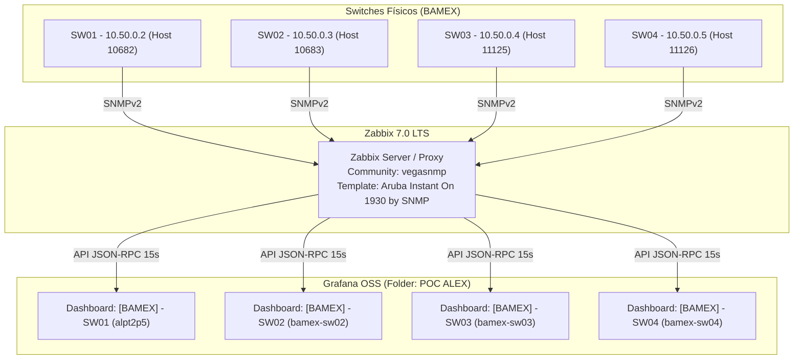

# Especificação Técnica Completa: Gêmeo Digital (Digital Twin) do Switch Aruba Instant On 1930
**Plataforma de Monitoramento e Observabilidade: Zabbix 7.0 LTS & Grafana OSS**  
**Versão da Solução: v58 (Multi-Switch, Template 64-bit HC, CPU & PoE Inteligente)**  
**Repositório:** [https://github.com/IDhexter/Grafana-Switch](https://github.com/IDhexter/Grafana-Switch) | **Operação:** Rede Corporativa BAMEX

---

## 1. Sumário Executivo e Objetivos Arquiteturais (v58)

### 1.1. Contexto Operacional
Em ambientes de rede corporativos e datacenters (NOC 24/7), a visualização tradicional de switches de acesso e agregação limita-se a tabelas estáticas ou gráficos de séries temporais desconexos da topologia física. 

Este projeto implementa um **Gêmeo Digital Físico Interativo (Digital Twin)** para a família de switches **Aruba Instant On 1930 24G 4SFP+ (Modelos JL682A, JL683A, JL684A)** na rede BAMEX (`SW01`, `SW02`, `SW03`, `SW04`), operando em conjunto com **Zabbix 7.0 LTS** e **Grafana OSS**.

### 1.2. Evolução v57 → v58: O que mudou?
1. **Multi-Switch Padronizado em Produção**:
   - `[BAMEX] - SW01 - Aruba Instant On 1930 (10.50.0.2)` (HostID: 10682, UID: `alpt2p5`) - Rack CPD
   - `[BAMEX] - SW02 - Aruba Instant On 1930 (10.50.0.3)` (HostID: 10683, UID: `bamex-sw02`)
   - `[BAMEX] - SW03 - Aruba Instant On 1930 (10.50.0.4)` (HostID: 11125, UID: `bamex-sw03`)
   - `[BAMEX] - SW04 - Aruba Instant On 1930 (10.50.0.5)` (HostID: 11126, UID: `bamex-sw04`)
   - Cada dashboard conecta e monitora independentemente seu respectivo switch no Zabbix.

2. **Template Customizado Zabbix 7.0 (`zbx70_aruba_instanton_1930_snmp.yaml`)**:
   - Migração para contadores de 64-bits High Capacity (`ifHCInOctets` e `ifHCOutOctets`) com delay de 1 minuto.
   - Pré-processamento multiplicador nativo de `1000000` em `ifHighSpeed` (convertendo Mbps para bps).
   - Coleta de Status Administrativo (`ifAdminStatus`) e ajuste de macro `{$NET.IF.IFADMINSTATUS.NOT_MATCHES} = CHANGE_IF_NEEDED`.
   - Coleta de utilização de CPU (`system.cpu.util`) via OID homologada `1.3.6.1.4.1.11.2.1.8.0` com trigger de alerta em 85% (`{$CPU.UTIL.CRIT}`).
   - Delays seletivos para proteção do banco de dados (1m tráfego e CPU, 3m erros/descartes, 5m velocidade e status).
   - 47 UUIDs v4 exclusivos para evitar qualquer colisão ou sobrescrita do template nativo.

3. **Arquitetura Adaptativa e Inteligente de PoE**:
   - Regra LLD de descoberta de PoE (`poe.discovery`) com protótipos de detecção de status e medição de consumo em Watts (`poe.status`, `poe.power`).
   - Diferenciação visual dinâmica: em switches Non-PoE (modelos JL682A), o dashboard permanece limpo e estável sem campos vazios; em switches com PoE nativo (JL683A/JL684A), ativa automaticamente o badge de potência no topo, o raio dourado `⚡` no RJ45 das portas que estiverem alimentando dispositivos e a medição em Watts no card de detalhes.

4. **Tratamento de Queda e Flaps Noturnos (Anti-Flap)**:
   - Suporte documentado à macro de contexto `{$IFCONTROL:"{#IFNAME}"} = 0` para suprimir alarmes de Link Down em computadores e estações que entram em modo Sleep / Wake-on-LAN durante a madrugada, preservando a coleta de tráfego normalmente.

5. **Script de Deploy Automatizado (`scripts/build_aruba_interactive_twin.ps1`)**:
   - Parametrizado para aceitar `-TargetHostId`, `-TargetDashboardUid`, `-TargetDashboardTitle`, `-TargetSwitchShortName`, `-TargetSwitchIp`.
   - Preservação dinâmica da pasta de destino no Grafana e correção de variáveis de ambiente reservadas do PowerShell.

---

## 2. Topologia de Rede e Dashboards em Produção



---

## 3. Matriz de Telemetria SNMP Homologada

| Métrica | OID SNMP / MIB | Tipo Zabbix | Intervalo | Comportamento no Switch / Gêmeo Digital |
| :--- | :--- | :---: | :---: | :--- |
| **Bits Recebidos (In)** | `1.3.6.1.2.1.31.1.1.1.6.{#SNMPINDEX}` (`ifHCInOctets`) | Inteiro 64-bit | 1m | Gráficos, Top Talkers e taxa de bits em tempo real. |
| **Bits Enviados (Out)** | `1.3.6.1.2.1.31.1.1.1.10.{#SNMPINDEX}` (`ifHCOutOctets`) | Inteiro 64-bit | 1m | Gráficos, Top Talkers e taxa de bits em tempo real. |
| **Velocidade da Porta** | `1.3.6.1.2.1.31.1.1.1.15.{#SNMPINDEX}` (`ifHighSpeed`) | Inteiro (bps) | 5m | Multiplicado por `1.000.000`. Detecta links degradados em 10M/100M. |
| **Status Operacional** | `1.3.6.1.2.1.2.2.1.8.{#SNMPINDEX}` (`ifOperStatus`) | Inteiro (1..7) | 1m | Define cor dos LEDs (Verde = UP, Cinza = DOWN, Âmbar = Degradado). |
| **Status Administrativo** | `1.3.6.1.2.1.2.2.1.7.{#SNMPINDEX}` (`ifAdminStatus`) | Inteiro (1..2) | 5m | Identifica portas em shutdown administrativo. |
| **CPU Utilization** | `1.3.6.1.4.1.11.2.1.8.0` (`HPE-rndMng` / `RADLAN`) | Float (%) | 1m | Badge no cabeçalho e na gaveta de inventário. Alerta > 85%. |
| **Uptime do Switch** | `1.3.6.1.2.1.1.3.0` (`sysUpTime`) | Uptime | 30s | Tempo de atividade contínuo no cabeçalho e na gaveta. |
| **PoE Detection Status** | `1.3.6.1.2.1.105.1.1.1.6.{#SNMPINDEX}` (`pethPsePortDetectionStatus`) | Inteiro (1..6) | 5m | Valor 3 acende o raio dourado `⚡` no RJ45. |
| **PoE Actual Power** | `1.3.6.1.2.1.105.1.1.1.10.{#SNMPINDEX}` (`pethPsePortActualPower`) | Float (W) | 5m | Exibe consumo em Watts no detalhe da porta selecionada. |

---

## 4. Engenharia de Link Down e Anti-Flap Noturno

A expressão de gatilho de Link Down no Zabbix 7.0 é:

```text
{$IFCONTROL:"{#IFNAME}"}=1 
and last(/Aruba Instant On 1930 by SNMP/net.if.status[ifOperStatus.{#SNMPINDEX}])=2 
and (last(/Aruba Instant On 1930 by SNMP/net.if.status[ifOperStatus.{#SNMPINDEX}],#1)<>last(/Aruba Instant On 1930 by SNMP/net.if.status[ifOperStatus.{#SNMPINDEX}],#2))
```

- **Por que esta expressão é segura:**
  Ela só dispara se a porta estava `UP` na coleta anterior e transitou para `DOWN` agora (`diff <> 0`). Portas desconectadas ou vazias nunca geram alarme.

- **Como silenciar portas de computadores normais:**
  Em estações que desligam ou entram em modo de suspensão de madrugada (gerando flaps de 1 minuto):
  No Zabbix &rarr; **Host** &rarr; **Macros** &rarr; Adicionar:
  `{$IFCONTROL:"1"} = 0` (onde `1` é o número da porta).
  Isso desativa o alarme de emergência da porta 1 mantendo a telemetria de tráfego e visualização normalmente.

---

## 5. Como Executar e Provisionar Novos Switches

Para implantar ou atualizar um switch instantaneamente:

```powershell
powershell -ExecutionPolicy Bypass -File .\scripts\build_aruba_interactive_twin.ps1 `
  -TargetHostId "10682" `
  -TargetDashboardUid "alpt2p5" `
  -TargetDashboardTitle "[BAMEX] - SW01 - Aruba Instant On 1930 (10.50.0.2)" `
  -TargetSwitchShortName "SW01" `
  -TargetSwitchIp "10.50.0.2"
```

O script realiza o ciclo completo:
1. Conecta na API do Zabbix e extrai o inventário de 28 portas, tráfego 64-bit, CPU, uptime e alarmes.
2. Compila o painel HTML/CSS/JS com todas as proteções de concorrência e memória.
3. Faz o deploy direto na API do Grafana com idempotência na pasta `POC ALEX`.

---

## 6. Histórico de Versões

- **v54 - v55**: Protótipo inicial, prova de conceito de chassi estático.
- **v56**: Introdução de histórico com Bézier e eventos brutos.
- **v57**: Auditoria técnica sênior, eliminação de memory leaks com Singleton `__ARUBA_TWIN_RUNTIME__`, Canvas com traçado linear (`lineTo`), travamento de altura 1080p (`gridPos.h = 28`), delimitadores de palavra em regex de alarmes.
- **v58 (Atual)**: Padronização multi-switch (`SW01` a `SW04`), Template Zabbix 7.0 64-bits High Capacity, CPU 1m (`1.3.6.1.4.1.11.2.1.8.0`), documentação anti-flap noturno e motor inteligente e adaptativo de PoE.
