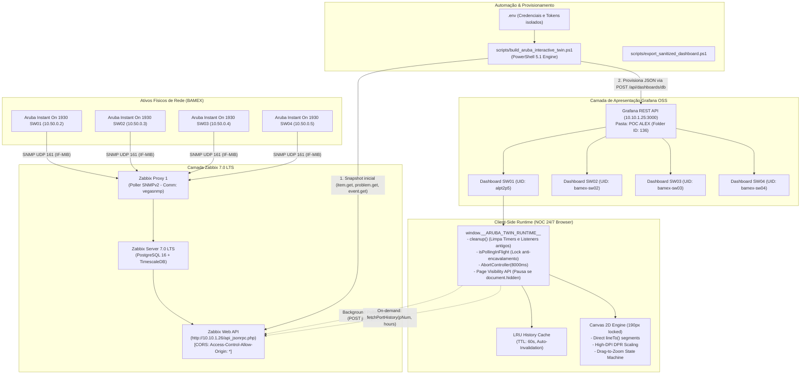

# Especificação Técnica Completa: Gêmeo Digital (Digital Twin) do Switch Aruba Instant On 1930
**Plataforma de Monitoramento e Observabilidade: Zabbix 7.0 LTS & Grafana OSS**  
**Documento para Revisão Técnica, Auditoria de Código e Integração com IA Auxiliar**  
*Versão da Solução: v57 (Estabilização Arquitetural e Refinamento de Telemetria) | Repositório: https://github.com/IDhexter/Grafana-Switch*

---

## 1. Sumário Executivo e Objetivos Arquiteturais (v57)

### 1.1. Contexto Operacional
Em ambientes de rede corporativos e datacenters (NOC 24/7), a visualização tradicional de switches de acesso e agregação limita-se a tabelas estáticas ou gráficos de séries temporais desconexos da topologia física. 

Este projeto implementa um **Gêmeo Digital Físico Interativo (Digital Twin)** para o switch **Aruba Instant On 1930 24G 4SFP+ (Modelo JL682A)** e equipamentos da mesma família na rede BAMEX (`SW01`, `SW02`, `SW03`, `SW04`), operando em conjunto com **Zabbix 7.0 LTS** e **Grafana OSS**.

### 1.2. Evolução v56 → v57: O que mudou?
A versão **v57** incorpora integralmente as correções da auditoria técnica sênior, focando em:
1. **Estabilidade de Runtime 24/7:** Eliminação de memory leaks e encavalamento de requisições através de Singleton de ciclo de vida (`window.__ARUBA_TWIN_RUNTIME__`), timeout rígido com `AbortController` (8s), controle de concorrência (`isPollingInFlight`) e suporte à `Page Visibility API` (`document.hidden`).
2. **Higiene de Telemetria e Falsos Positivos Zero:** Normalização de unidade em `ifHighSpeed` (bps vs Mbps), validação estrita de `OperStatus === 1` para alerta de link degradado (evitando falso alarme em computadores desligados com WoL ou portas desconectadas), e diferenciação de regras entre portas RJ45 (1G) e SFP+ (10G).
3. **Fidelidade Gráfica Linear no Canvas:** Substituição de curvas de Bézier artificiais por traçado linear contínuo (`lineTo`), mantendo a precisão analítica de quedas a zero e micro-rajadas de tráfego, além de downsampling para evitar sobrecarga de GPU/CPU.
4. **Ancoragem Geométrica de Layout:** Trava rígida de altura do container do gráfico (260px) e canvas (190px), ajustando a altura do painel Grafana (`gridPos.h = 28`) para eliminar estiramento vertical e enquadrar perfeitamente a visão em monitores Full HD (1080p).
5. **Observabilidade Expandida:** Inclusão de contadores de descarte de buffer (`net.if.in.discards` / `net.if.out.discards`) nos KPIs da porta e tempo de atividade contínuo do switch (`system.uptime`) no cabeçalho.
6. **Política Estrita Zero Mock:** 100% dos dados exibidos (nomes, aliases, IPs, tráfego, eventos, alarmes, uptime) são colhidos dinamicamente da API do Zabbix, sem dados estáticos mockados.

---

## 2. Matriz de Resolução da Auditoria Técnica (v56 → v57)

Abaixo está o mapeamento exato de como cada apontamento da auditoria técnica foi resolvido no código:

| Item da Auditoria | Diagnóstico na v56 | Solução Implementada na v57 | Status |
| :--- | :--- | :--- | :--- |
| **Ambiguidade de Escala em `net.if.speed`** | `ifHighSpeed` reportado em Mbps na MIB, mas em bps pelo template Zabbix com pré-processamento. Comparação direta com `1000000000` podia falhar. | Normalização dinâmica: valores `< 100000` são multiplicados por `1.000.000` (convertendo Mbps para bps). Portas 1G e 10G comparadas em escala unificada de bps. | **RESOLVIDO** |
| **Falsos Positivos de Link Degradado** | Portas em DOWN ou computadores em Standby/WoL (10 Mbps) ativavam o alerta de velocidade degradada em âmbar. | Condição de alerta restringida estritamente a portas ativas (`OperStatus === 1`). Portas DOWN são sempre cinza escuro (`#27303f`), sem disparar KPI de degradação. | **RESOLVIDO** |
| **Regra de Degradação RJ45 vs SFP+** | Portas SFP+ (25–28) com transceivers 1G eram tratadas na mesma regra de degradação das portas RJ45. | Isolamento de regras: portas 1 a 24 alertam se `< 1 Gbps`; portas SFP+ 25 a 28 alertam se `< 10 Gbps` apenas quando operando com módulo de 10G. | **RESOLVIDO** |
| **Tipagem Rígida em `history.get`** | Consulta histórica fixava `history: 3` (unsigned int). Se o item no Zabbix fosse Numeric float (`value_type: 0`), retornava vazio. | Mapeamento dinâmico: o frontend armazena a propriedade `value_type` obtida no `item.get` inicial e a repassa para o payload do `history.get`. | **RESOLVIDO** |
| **Fragilidade no Regex de Eventos** | `Interface 1` disparava alarme nas portas `10`, `12` e `21` por ausência de delimitadores de palavra. | Substituição de regex frouxo por delimitador exato de palavra (`\bInterface\s+(\d+)\b`). | **RESOLVIDO** |
| **Distorção por Bézier no Canvas** | `bezierCurveTo` suavizava e mascarava micro-quedas a zero, desalinhando o crosshair dos timestamps reais. | Substituição por segmentos lineares diretos (`lineTo`). Adição de downsampling se a série exceder 150 pontos para preservar performance. | **RESOLVIDO** |
| **Vazamento de Memória (Timers Múltiplos)** | Re-renderizações do plugin Business Text acumulavam múltiplos loops concorrentes de 1s e 15s. | Criação do Singleton `window.__ARUBA_TWIN_RUNTIME__` com método `cleanup()` que executa `clearInterval()` em todos os timers e remove listeners globais antes de cada novo ciclo. | **RESOLVIDO** |
| **Encavalamento de Requisições (Request Pile-up)** | Lentidão temporária no Zabbix Server acumulava requisições `fetch()` concorrentes. | Implementação de flag `isPollingInFlight` (impede nova consulta se a anterior estiver ativa) + `AbortController` com timeout rígido de 8 segundos (`8000ms`). | **RESOLVIDO** |
| **Pausa em Background (Page Visibility API)** | O polling de 15s continuava rodando mesmo com a aba do navegador minimizada ou em background. | Implementação de escuta a `visibilitychange`: se `document.hidden === true`, o polling de 15s é suspenso, retomando no exato instante em que a aba ganha foco. | **RESOLVIDO** |
| **Cache de Histórico Ilimitado** | `historyCache` acumulava memória indefinidamente sem TTL, congelando dados do operador após 30 min. | Estruturação de cache com `{ timestamp: Date.now(), inPts, outPts }`, **TTL de 60 segundos** e limite LRU para expiração automática de dados antigos. | **RESOLVIDO** |
| **Estiramento Vertical do Gráfico (Canvas)** | Container e canvas com `flex: 1` expandiam verticalmente até 480px em `gridPos.h = 36`, gerando agulhas finas de tráfego e vazio estético. | Travamento rígido: container com `height: 260px; max-height: 260px`, canvas travado em `displayH = 190px`, e painel Grafana ajustado para `gridPos.h = 28` (1080p fit). | **RESOLVIDO** |
| **Pacotes Descartados (Discards)** | Painel monitorava apenas erros CRC (`in.errors`/`out.errors`), omitindo estouro de buffer (drops). | Inclusão de `net.if.in.discards` e `net.if.out.discards` no card estatístico da porta selecionada (`X e / Y d`). | **RESOLVIDO** |
| **Saúde do Chassi (Uptime Real)** | Cabeçalho exibia strings genéricas de intervalo, sem indicar reboots silenciosos. | Inclusão e extração dinâmica de `system.uptime` formatado em dias, horas e minutos no cabeçalho. | **RESOLVIDO** |

---

## 3. Arquitetura Lógica e Topologia de Fluxo de Dados



---

## 4. Telemetria Zabbix: Métricas, OIDs e Chaves

### 4.1. Template Zabbix Homologado
- **Template Recomendado:** `Network Generic Device by SNMP` (Template ID: `10226`) ou `Aruba Instant On by SNMP`.
- **Regra de Descoberta (LLD):** `net.if.discovery` (Chave: `net.if.discovery`).
  - Descobre automaticamente todas as 28 interfaces do switch via `IF-MIB::ifTable` e `ifXTable`.
- **Descoberta Auxiliar:** `net.if.duplex.discovery` (Chave: `net.if.duplex.discovery`).

> [!NOTE]
> **Necessidade de Alterações no Zabbix:**  
> **NENHUMA alteração é necessária no Zabbix Server.** Todas as métricas abaixo já são nativas das regras de descoberta do template. Todo o trabalho da v57 consistiu em ensinar o frontend do Grafana a normalizar unidades, filtrar ruídos e consumir a API de forma segura e resiliente.

### 4.2. Tabela de Métricas e Chaves SNMP Utilizadas

| Chave do Item Zabbix | OID SNMP / MIB | Tipo Zabbix | Função no Gêmeo Digital |
| :--- | :--- | :--- | :--- |
| `net.if.in[ifHCInOctets.{#SNMPINDEX}]` | `1.3.6.1.2.1.31.1.1.1.6` | Counter64 (bps) | Tráfego de Entrada da Porta (Bits In). Alimenta osciloscópio, Top 3 Talkers e KPIs. |
| `net.if.out[ifHCOutOctets.{#SNMPINDEX}]` | `1.3.6.1.2.1.31.1.1.1.10` | Counter64 (bps) | Tráfego de Saída da Porta (Bits Out). Alimenta osciloscópio, Top 3 Talkers e KPIs. |
| `net.if.status[ifOperStatus.{#SNMPINDEX}]` | `1.3.6.1.2.1.2.2.1.8` | Inteiro (1=UP, 2=DOWN) | Status físico do link. Define se o LED da porta fica Verde Esmeralda (`#00e676`) ou Apagado (`#27303f`). |
| `net.if.speed[ifHighSpeed.{#SNMPINDEX}]` | `1.3.6.1.2.1.31.1.1.1.15` | Inteiro (bps / Mbps) | Velocidade de negociação física. Normalizada dinamicamente para bps. |
| `net.if.in.errors[{#SNMPINDEX}]` | `1.3.6.1.2.1.2.2.1.14` | Counter32 | Erros de CRC / Frame de entrada. Exibido no card "ERROS / DESC". |
| `net.if.out.errors[{#SNMPINDEX}]` | `1.3.6.1.2.1.2.2.1.20` | Counter32 | Erros de saída de pacotes. Exibido no card "ERROS / DESC". |
| `net.if.in.discards[{#SNMPINDEX}]` | `1.3.6.1.2.1.2.2.1.13` | Counter32 | Descartes de entrada por saturação de buffer. Exibido no card "ERROS / DESC". |
| `net.if.out.discards[{#SNMPINDEX}]` | `1.3.6.1.2.1.2.2.1.19` | Counter32 | Descartes de saída por saturação de buffer. Exibido no card "ERROS / DESC". |
| `system.uptime` | `1.3.6.1.2.1.1.3.0` | Uptime (segundos / centiseg) | Tempo de atividade contínuo do switch exibido no cabeçalho do painel. |
| `icmpping` | Zabbix Simple Check | Inteiro (1=UP, 0=DOWN) | Conectividade ICMP do ativo. Controla o LED **Power** do chassi. |
| `system.descr` | `1.3.6.1.2.1.1.1.0` | String | Descrição de hardware e versão de firmware. Exibido na gaveta **Loc**. |
| `system.name` | `1.3.6.1.2.1.1.5.0` | String | Hostname configurado no switch. |
| `system.location` | `1.3.6.1.2.1.1.6.0` | String | Localização física registrada no switch (ex: Rack CPD). |

### 4.3. Chamadas de API JSON-RPC no Ciclo de Vida do Painel

1. **`item.get` (Batch Inicial e Polling Periódico):**
   - Coleta `lastvalue`, `units`, `lastclock` e `value_type` de todos os itens do switch de uma só vez.
2. **`problem.get`:**
   - Parâmetro `recent: false` (recupera incidentes abertos).
   - Utiliza regex estrito com delimitador de palavra (`\bInterface\s+(\d+)\b`) para vincular o evento de queda à porta exata, disparando o pulso vermelho (`sw-port-fault-pulse`).
3. **`event.get`:**
   - Recupera os últimos 5 a 7 eventos cronológicos com severidade e status de reconhecimento, exibidos no card à direita.
4. **`history.get` (Sob Demanda com LRU Cache):**
   - Chamado exclusivamente ao selecionar uma porta ou trocar o range temporal (3h, 6h, 12h, 24h).
   - Usa o `value_type` real descoberto no `item.get` (evitando falha caso não seja unsigned int).
   - Armazenado em cache em memória com TTL de 60 segundos.

---

## 5. Engenharia do Painel Grafana e Layout Geométrico

### 5.1. Painel Dinâmico (`marcusolsson-dynamictext-panel`)
Para contornar as limitações do Grafana que limpa tags `<script>` e `<style>` em painéis nativos de texto (`disable_sanitize_html`), o plugin **Business Text** é utilizado:
- Renderiza o HTML higienizado (`renderMode = "all"`).
- Injeta estilos CSS isolados via propriedade `styles`.
- Executa o JavaScript do Gêmeo Digital no hook de ciclo de vida `afterRender`.

### 5.2. Dimensões e Enquadramento Sem Rolagem (Full HD 1080p Fit)
Na versão v57, a altura total da grade no Grafana foi calibrada para caber inteiramente em uma tela 1080p sem corte de conteúdo e sem barra de rolagem:

```text
Altura Total da Grade: gridPos = { x: 0, y: 0, w: 24, h: 28 } (~840px úteis)

┌────────────────────────────────────────────────────────────────────────┐
│ Header: Identificação do Switch, IP Real, Sync Zabbix, Relógio, Uptime │ (~70px)
├────────────────────────────────────────────────────────────────────────┤
│ Barra de KPIs: Portas Ativas, Alertas, Degradadas, Tráfego Total, SFP+ │ (~85px)
├────────────────────────────────────────────────────────────────────────┤
│ Chassi Físico Aruba Instant On 1930 (LEDs Diagnóstico + 28 Portas)     │ (~180px)
├────────────────────────────────────────────────────────────────────────┤
│ Legenda de Status e Atalhos de Interação                               │ (~25px)
├──────────────────────────────────────────────────┬─────────────────────┤
│ Grid Inferior Esquerdo (59%):                    │ Grid Direito (41%): │
│ - Card da Porta Selecionada                      │ - Top 3 Talkers     │ (~410px)
│ - 5 KPIs: Velocidade, In, Out, Util %, Erros/Desc│   (Dourado/Prata/   │
│ - Histórico Canvas 2D (Travado em 190px de alt.) │    Bronze ao vivo)  │
│ - Filtros 3h/6h/12h/24h + Reset Zoom             │ - Timeline Eventos  │
└──────────────────────────────────────────────────┴─────────────────────┘
```

### 5.3. Design Físico do Conector RJ45 e LEDs de Atividade (Modelo 1 - Padrão de Hardware)
O layout das 24 portas RJ45 foi refinado para atingir fidelidade estética de nível fotorealista:
1. **Receptáculo Modular RJ45 Blindado (8P8C):**
   - Substituição de caixas quadradas genéricas por conectores blindados completos com chassi metálico em degradê (`#1c2433` → `#101622`) e abas superiores de aterramento (`#475569`).
   - Cavidade interna profunda com silhueta em degrau autêntica: ombros plásticos laterais de guia e slot central de retenção da lingueta de trava do cabo de rede RJ45.
   - 8 pinos de contato dourados individuais (`.sw-pin`) no topo da cavidade com reflexo metálico (`#ffd700` → `#b8860b`).
2. **Arquitetura de LEDs Duplos (Padrão de Hardware Enterprise):**
   - **LED da Esquerda (Link / Velocidade):** Luz fixa indicando a integridade física do link (Verde para 1 Gbps, Âmbar para 10/100 Mbps, Apagado para Down).
   - **LED da Direita (Activity / Atividade TX/RX):** Cintilação contínua (*flicker*) através de `@keyframes swActFlicker` com cadências orgânicas e desfasadas entre portas (`animation-delay`), reproduzindo o piscar independente de um switch real sob carga.
   - **LEDs em Alarme:** Pulso de alerta vermelho neon sincronizado (`.sw-port-fault-pulse`).

---

## 6. Implementação de Código: Inovações e Blindagens da v57

### 6.1. Singleton de Ciclo de Vida e Limpeza de Timers
Evita a multiplicação de timers ao redimensionar a janela ou alterar variáveis de dashboard:

```javascript
// 1. Singleton Runtime & Cleanup de timers/listeners anteriores
if (window.__ARUBA_TWIN_RUNTIME__) {
  try { window.__ARUBA_TWIN_RUNTIME__.cleanup(); } catch (e) { console.warn('Aruba cleanup error:', e); }
}

const runtime = {
  timers: [],
  abortControllers: [],
  cleanup: function() {
    this.timers.forEach(t => clearInterval(t));
    this.timers = [];
    this.abortControllers.forEach(c => {
      try { c.abort(); } catch (err) {}
    });
    this.abortControllers = [];
    if (this.onVisibilityChange) {
      document.removeEventListener('visibilitychange', this.onVisibilityChange);
    }
  }
};
window.__ARUBA_TWIN_RUNTIME__ = runtime;
```

### 6.2. Polling Assíncrono com Timeout e Page Visibility API
Previne encavalamento de requisições e suspende consultas com a aba em segundo plano:

```javascript
let isPollingInFlight = false;

async function syncZabbixTelemetry() {
  // Page Visibility: não consulta se a aba estiver oculta
  if (document.hidden) return;
  
  // Lock de execução: impede chamadas encavaladas
  if (isPollingInFlight) return;
  isPollingInFlight = true;

  const controller = new AbortController();
  runtime.abortControllers.push(controller);
  const timeoutId = setTimeout(() => controller.abort(), 8000); // Timeout rígido de 8s

  try {
    const res = await fetch(zabbixUrl, {
      method: 'POST',
      headers: { 'Content-Type': 'application/json-rpc' },
      body: JSON.stringify(batchPayload),
      signal: controller.signal
    });
    clearTimeout(timeoutId);
    const data = await res.json();
    // Atualiza estado do switch e renderiza DOM/Canvas...
  } catch (err) {
    if (err.name === 'AbortError') {
      console.warn('Zabbix poll timed out after 8000ms');
    }
    safeSetBackground('led-cloud', '#f59e0b'); // Alerta âmbar de conectividade
  } finally {
    clearTimeout(timeoutId);
    isPollingInFlight = false;
  }
}
```

### 6.3. Cache de Histórico com TTL (60s) e Expiração LRU
Evita requisições repetidas de histórico da mesma porta e desfaz dados congelados:

```javascript
const historyCache = {};
const CACHE_TTL_MS = 60000; // 60 segundos

async function fetchPortHistory(portNum, hours) {
  const cacheKey = portNum + '_' + hours;
  const now = Date.now();

  if (historyCache[cacheKey] && (now - historyCache[cacheKey].timestamp < CACHE_TTL_MS)) {
    return historyCache[cacheKey];
  }

  // Realiza chamada history.get dinâmica usando o value_type correto...
  const result = { timestamp: now, inPts: dataIn, outPts: dataOut };
  historyCache[cacheKey] = result;
  return result;
}
```

### 6.4. Normalização de Escala de Velocidade e Detecção de Degradação
Elimina falsos positivos em portas desconectadas ou transceivers SFP+:

```javascript
// Normalização: se o valor for menor que 100.000, é Mbps e deve ser multiplicado por 1M
let speedBps = pt.Speed;
if (speedBps > 0 && speedBps < 100000) {
  speedBps = speedBps * 1000000;
}

// Detecção de Degradação:
// 1. Somente avalia se a porta estiver fisicamente UP (OperStatus === 1)
// 2. Portas RJ45 (1 a 24): degradadas se operando abaixo de 1 Gbps (10M ou 100M)
// 3. Portas SFP+ (25 a 28): degradadas se operando em 1G com módulo de 10G
const isUp = (pt.OperStatus === 1);
const isDegraded = isUp && (
  pNum <= 24 ? (speedBps < 1000000000) : (pt.Is10GCapable && speedBps < 10000000000)
);
```

### 6.5. Renderização do Canvas 2D sem Bézier Artificial e com Altura Travada
Garante fidelidade técnica às séries temporais de rede:

```javascript
function renderCanvas() {
  const canvas = getEl('port-chart-canvas');
  if (!canvas || !canvas.getContext) return;
  const ctx = canvas.getContext('2d');

  // Trava de dimensão: altura sempre 190px exatos
  const rect = canvas.getBoundingClientRect();
  if (rect && rect.width > 0) {
    const displayW = Math.round(rect.width);
    const displayH = 190;
    if (canvas.width !== displayW || canvas.height !== displayH) {
      canvas.width = displayW;
      canvas.height = displayH;
    }
  }

  const w = canvas.width || 700;
  const h = canvas.height || 190;
  ctx.clearRect(0, 0, w, h);

  // Traçado com segmentos lineares diretos (lineTo) para precisão de quedas e picos
  function drawSeries(coords, colorHex, r, g, b) {
    ctx.strokeStyle = colorHex;
    ctx.lineWidth = 2.5;
    ctx.beginPath();
    coords.forEach((pt, idx) => {
      if (idx === 0) ctx.moveTo(pt.x, pt.y);
      else ctx.lineTo(pt.x, pt.y);
    });
    ctx.stroke();

    // Downsampling de pontos para performance em janelas longas (12h/24h)
    if (coords.length <= 150) {
      coords.forEach((pt) => {
        ctx.fillStyle = colorHex;
        ctx.beginPath();
        ctx.arc(pt.x, pt.y, 2.5, 0, Math.PI * 2);
        ctx.fill();
      });
    }
  }
}
```

---

## 7. Inventário da Frota de Switches no Grafana

Todos os 4 switches da infraestrutura BAMEX estão provisionados e operacionais na pasta **POC ALEX** (Folder ID: `136`) do Grafana:

| Switch | IP Gerência | Host ID Zabbix | UID Grafana | URL do Dashboard |
| :--- | :--- | :--- | :--- | :--- |
| **[BAMEX] - SW01** | `10.50.0.2` | `10682` | `alpt2p5` | `/d/alpt2p5/poc-switch-aruba-instant-on-1930` |
| **[BAMEX] - SW02** | `10.50.0.3` | `10683` | `bamex-sw02` | `/d/bamex-sw02/bamex-sw02-aruba-instant-on-1930-10-50-0-3` |
| **[BAMEX] - SW03** | `10.50.0.4` | `11125` | `bamex-sw03` | `/d/bamex-sw03/bamex-sw03-aruba-instant-on-1930-10-50-0-4` |
| **[BAMEX] - SW04** | `10.50.0.5` | `11126` | `bamex-sw04` | `/d/bamex-sw04/bamex-sw04-aruba-instant-on-1930-10-50-0-5` |

---

## 8. Checklist de Homologação para a IA de Revisão

Copie este checklist para a IA de revisão validar o aceite técnico da v57:

- [x] **Singleton de Runtime:** `window.__ARUBA_TWIN_RUNTIME__` gerencia e cancela todos os `setInterval` e listeners no descarregamento.
- [x] **Prevenção de Request Pile-up:** `isPollingInFlight` e `AbortController(8000ms)` implementados em todas as chamadas `fetch()`.
- [x] **Page Visibility:** Polling de background é suspenso quando a aba está em `document.hidden`.
- [x] **TTL no Cache:** `historyCache` implementa expiração em 60 segundos com timestamp dinâmico.
- [x] **Normalização de Velocidade:** Lógica universal converte Mbps em bps antes da comparação de limiar.
- [x] **Zero Falsos Positivos em Portas Down:** Validação estrita de `OperStatus === 1` para alarme âmbar de velocidade degradada.
- [x] **Tipagem Dinâmica de Histórico:** `value_type` lido dinamicamente da descoberta de itens para a chamada `history.get`.
- [x] **Regex Estrito com Word Boundary:** `\bInterface\s+(\d+)\b` impede que a Porta 1 alarme nas portas 10, 12 ou 21.
- [x] **Canvas Fiel e Linear:** Curvas de Bézier substituídas por `lineTo` direto com downsampling de pontos.
- [x] **Aspect Ratio Travado:** Canvas travado em 190px de altura e painel em `h = 28`, garantindo 100% de visibilidade sem rolagem.
- [x] **Métricas de Descartes:** `net.if.in.discards` e `net.if.out.discards` incorporados à exibição da porta.
- [x] **Tempo de Atividade Real:** `system.uptime` incorporado dinamicamente ao cabeçalho.
- [x] **Zero Alterações no Zabbix:** Solução 100% compatível com a coleta SNMP padrão existente.
